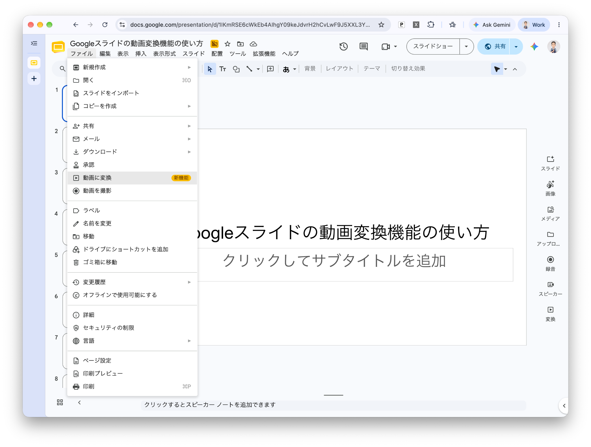
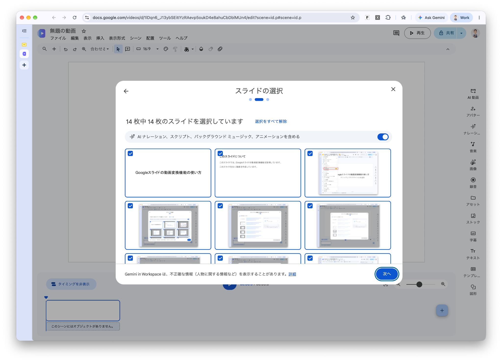
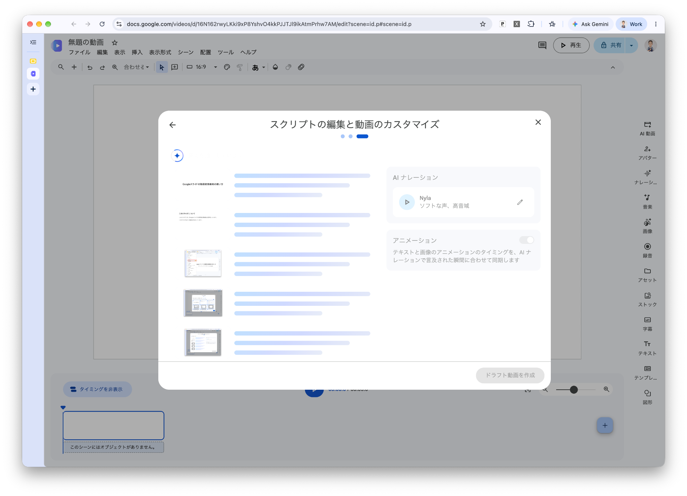
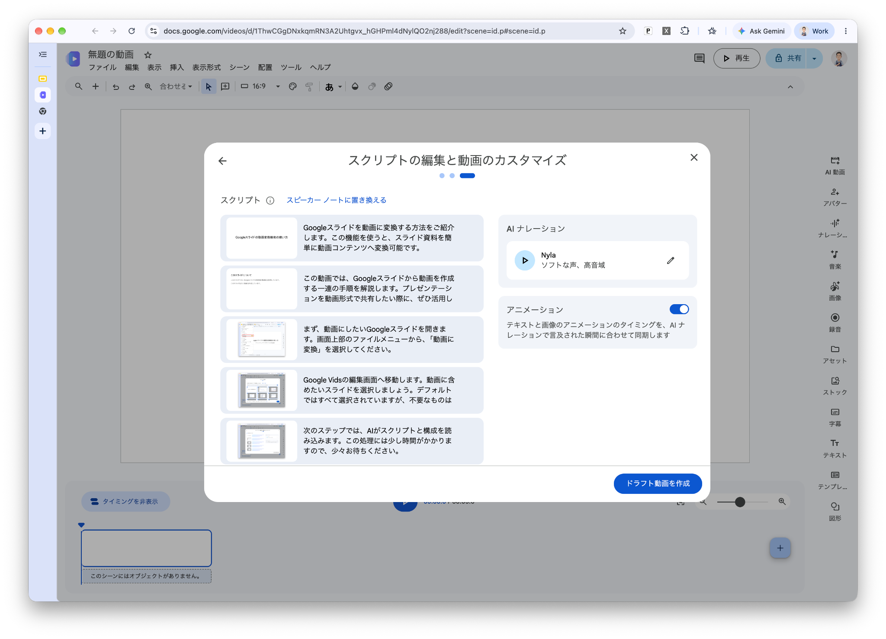
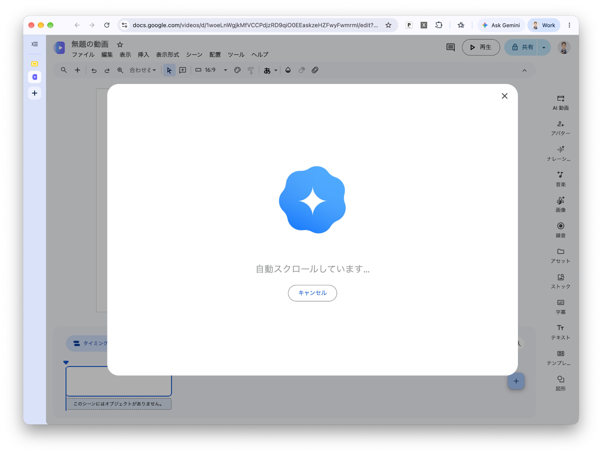
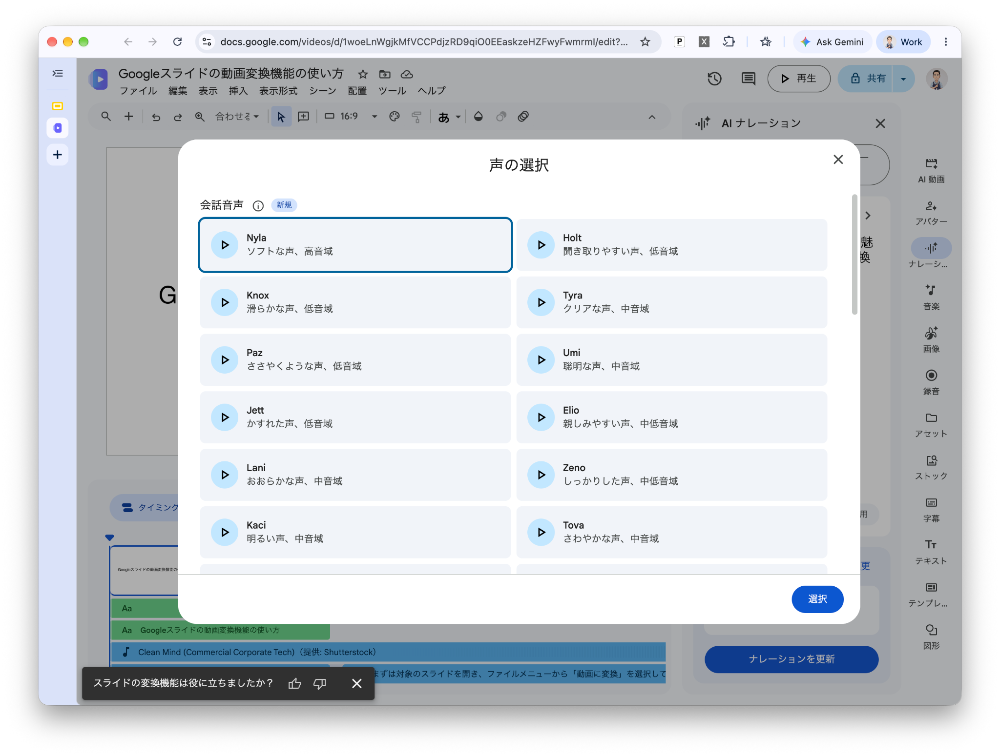
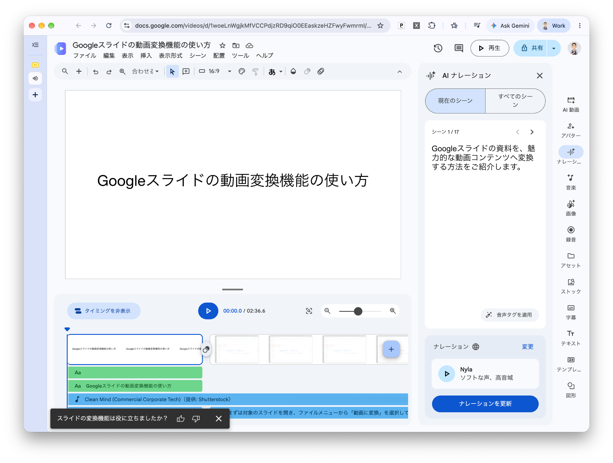
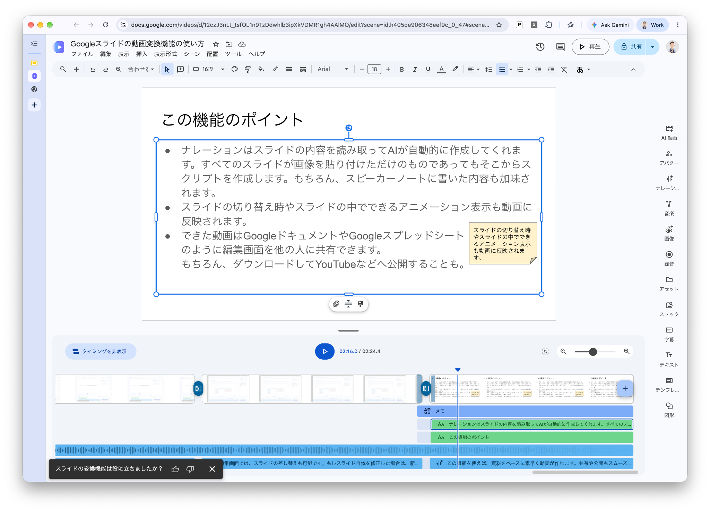

## 概要

Googleスライドに「動画に変換」という機能が加わりました。これがかなりいいんです。

ファイルメニューから「動画に変換」を選ぶだけで、AIがスライドを読み取ってナレーション（読み上げ音声）を付けた動画にしてくれます。BGMやアニメーションまで付けてくれます。

いちばん驚いたのはナレーションの自然さです。スライドの文字をそのまま読み上げるのではなく、「このスライドは何を伝えたいのか」という流れをちゃんと汲み取って、いい感じの話し言葉にしてくれます。操作画面の画像を貼っただけのスライドでも、画面の中身を読み取って説明してくれるのには感心しました。

できあがった動画は、Google Vids（グーグル ビッズ）というGoogleの動画編集アプリで開きます。GoogleドキュメントやGoogleスプレッドシートのように、ブラウザだけで動画を作ったり直したりできるアプリです。

この記事では、実際にスライドを動画にしてみた手順を紹介します。最後に、使ったスライドとできあがった動画、YouTubeで公開した動画も載せているので、ナレーションがどれくらい自然か、ぜひ聴いてみてください。

## 動画に変換する手順

### 1. スライドを開いて「動画に変換」を選ぶ

動画にしたいスライドを開き、ファイルメニューから「動画に変換」を選びます。

### 2. 動画に含めるスライドを選ぶ

画面がGoogle Vidsに切り替わり、動画に含めるスライドを選ぶ画面になります。最初はすべてのスライドが選ばれているので、動画に入れたくないスライドのチェックをはずして「次へ」を押します。

### 3. 読み込みが終わるまで待つ

スライドの読み込みが始まります。ここでかなり時間がかかります。「ドラフト動画を作成」ボタンが押せるようになるまでは待つしかありません。

### 4. 「ドラフト動画を作成」を押す

「ドラフト動画を作成」ボタンが押せるようになったら、押して先へ進みます。ドラフトとは下書きのことで、このあと内容を確認しながら手直しできます。

### 5. 動画ができあがるまで待つ

ここから実際に動画の作成が始まります。ここでも時間がかかります。

### 6. できあがった動画を確認する

動画ができあがると、スライドの下にタイムライン（時間の流れに沿って場面や音声を並べた帯）が表示されます。

右側の「ナレーション」をクリックすると、各スライドのナレーションが表示されます。Google Vidsでは、動画の中の1枚1枚のスライドを「シーン」と呼びます。

ナレーションの内容は、スライドに書かれた内容とスピーカーノート（発表者用のメモ欄）の内容から自動で作られます。スライドの中に図や画像があれば、その内容もナレーションに反映されますし、ちょうどよいタイミングでアニメーションも付けてくれます。このあたりは、実際に試してみるのがいちばんわかりやすいと思います。

## ナレーションの声を変える

### 1. 声の選択画面を開く

ナレーション欄の右上にある「変更」を押すと、声の選択画面に切り替わります。

### 2. 声を選ぶ

選べる声は、動画を作る前の選択画面よりもこちらの方がたくさん表示されます。それぞれの声に「ソフトな声、高音域」のような説明が付いていますが、実際に聴いてみないとわかりませんし、動画に当てはめてみないとしっくりくるかどうかわからないかもしれません。

### 3. ナレーションを更新する

声の変更は、今のシーンだけに当てはめるか、すべてのシーンに当てはめるかを選べます。

声を選んだり、ナレーションの文章を書き換えたりしたら、「ナレーションを更新」を押して反映させます。

## スライドの内容を直す

動画に映るスライドの内容は、Google Vidsの編集画面でも直せます。

注意したいのは、元のGoogleスライドを書き換えても、動画には自動で反映されない点です。スライドの方を直したときは、そのスライドをコピーしてGoogle Vidsに貼り付け、追加したり差し替えたりします。

## この機能のよいところ

### ナレーション原稿をAIが作ってくれる

ナレーションの原稿は、スライドの内容を読み取ってAIが自動で作ってくれます。すべてのスライドが画面の画像を貼っただけのものであっても、その画像から原稿を作ってくれます。もちろん、スピーカーノートに書いた内容も加味されます。

今回のスライドも、ほとんどが操作画面の画像を貼っただけのものでしたが、それらしいナレーションが付きました。

### 共有もダウンロードもできる

できた動画は、GoogleドキュメントやGoogleスプレッドシートと同じように、編集画面をほかの人と共有できます。ダウンロードして、YouTubeなどで公開することもできます。

## 実際に作ったもの

今回の記事は、ここまでの手順をまとめたスライドを実際に動画に変換して書いています。

### 使ったスライド

https://docs.google.com/presentation/d/1IKmRSE6cWkEb4AIhgY09keJdvrH2hCvLwF9J5XXL3YM/edit?usp=sharing

### 変換後の動画（Google Vids）

https://docs.google.com/videos/d/1Q7RTwn7Uxx7YtQfOuAECcR9DuqZhLuhr_BuMLc-fADg/play?usp=sharing

### YouTubeで公開した動画

https://youtu.be/s-rAR5EJO-4

## まとめ

Googleスライドの「動画に変換」は、手元のスライドからナレーション付きの動画をほぼおまかせで作ってくれる機能です。読み込みや作成には少し時間がかかりますが、そのあいだは待っているだけなので、コーヒーでも飲んでいればOKです。

なにより最高なのは、ナレーションが自然なことです。スライドの流れを読み取って、ちゃんと「説明している」感じのナレーションにしてくれるので、自分で原稿を書いて録音する手間がまるごとなくなります。気になるところがあれば、あとから文章や声を直すこともできます。

研修資料や操作説明のスライドを動画にしておけば、その場にいなかった人にも同じ説明を届けられます。研修動画を作りたいけど、ナレーションを録るのは面倒……という方には、とくにおすすめです。すでに作ったスライドがあれば、ぜひ一度試してみてください。
