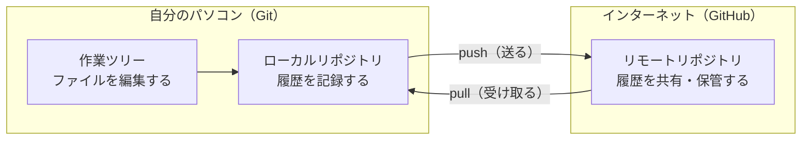

## ファイル名で管理するのをやめたい

こんなフォルダを見たことはないでしょうか。

```
企画書.docx
企画書_修正版.docx
企画書_修正版2.docx
企画書_最終.docx
企画書_最終_田中さん確認済.docx
企画書_最終_本当に最終.docx
```

これは、原始的な**バージョン管理**です。「前の状態を残しておきたい」「誰がどこを直したのか知りたい」という気持ちは正しいのですが、この方法には限界があります。

- どれが最新かわからなくなる
- どこが変わったのか、開いて見比べないとわからない
- 2人が同時に直すと、どちらかの変更が消える
- ファイルが増え続けて、ディスクを圧迫する

これらをまとめて解決してくれるのが、**バージョン管理システム**です。

---

## バージョン管理システムがしてくれること

バージョン管理システムを使うと、ファイルは常に1つのままで、**変更の履歴だけが裏側に積み上がっていきます**。

具体的には、次のことができます。

### 変更の履歴が残る

「いつ」「誰が」「どのファイルの」「どこを」変更したのかが、すべて記録されます。しかも、そのときに「なぜ変更したのか」というメモを添えられます。

### いつでも過去に戻れる

「昨日の状態では動いていたのに、今日おかしくなった」というとき、昨日の状態をすぐに取り出せます。うっかりファイルを消してしまっても復元できます。

### 変更点だけを見比べられる

ファイル全体を目で追わなくても、「この修正で変わったのはこの3行だけ」といった形で差分を確認できます。

### 複数人の作業を合流させられる

AさんとBさんが別々の場所を直しても、システムが自動的にひとつにまとめてくれます。同じ場所を直してしまった場合は「ここがぶつかっています」と教えてくれるので、人間が判断して解決します。

---

## Gitとは

**Git** は、いま世界でもっとも使われているバージョン管理システムです。2005年、Linuxカーネル（基本ソフトLinuxの中核部分）を開発するために作られました。

Gitの特徴は、**自分のパソコンの中に履歴のすべてが入っている**という点です。インターネットにつながっていなくても、履歴を見たり、過去に戻したり、新しい記録を作ったりできます。

```
自分のパソコン
├── 作業中のファイル
└── .git ← ここに全履歴が入っている
```

この `.git` というフォルダが、Gitの本体です。ファイルを直接開くことはありませんが、「履歴はここに入っているんだな」と覚えておいてください。

:::message
Gitはプログラムのソースコードだけでなく、文章・設定ファイル・CSVなど、**文字で書かれたファイル**なら何でも管理できます。この本でも、Markdownで書いたメモを題材にします。
:::

---

## GitHubとは

**GitHub** は、Gitの履歴をインターネット上に置いて共有できるサービスです。

Gitは自分のパソコンの中だけで完結するので、そのままでは次のことができません。

- パソコンが壊れたときに履歴を守る
- 別のパソコンで続きの作業をする
- 他の人に自分のコードを見てもらう
- チームで同じプロジェクトを進める

GitHubは、この「インターネット上の置き場所」を提供してくれます。加えて、次のような開発を助ける機能もついています。

| 機能 | 何ができるか |
|---|---|
| リポジトリのホスティング | 履歴つきでコードを保管する |
| プルリクエスト | 変更をレビューしてから取り込む |
| Issue | やることや不具合を管理する |
| Actions | テストや公開作業を自動化する |
| Pages | Webサイトとして公開する |

---

## GitとGitHubの関係

よくある誤解が「GitとGitHubは同じもの」というものです。実際には、はっきりと役割が分かれています。

| | Git | GitHub |
|---|---|---|
| 正体 | パソコンで動くソフトウェア | インターネット上のサービス |
| 役割 | 履歴を記録する | 履歴を共有・保管する |
| 使う場所 | 自分のパソコン | ブラウザ |
| 提供元 | オープンソース | GitHub社（Microsoft傘下） |
| なしで済むか | Gitがないと始まらない | なくてもGitは使える |

2つの関係を図にすると、次のようになります。



履歴を記録するところまではGitだけで完結します。GitHubは、その履歴を外に置いて共有するための場所です。

イメージとしては、次のような関係です。

- **Git** = 写真を撮るカメラ
- **GitHub** = 撮った写真を保管して、人に見せられるオンラインアルバム

カメラだけでも写真は撮れます。アルバムに載せるのは、保管したいときや人に見せたいときです。

:::message
GitHubと似たサービスに、GitLab、Bitbucket、Azure DevOpsなどがあります。どれもGitの置き場所を提供するサービスなので、Gitの操作方法はまったく同じです。この本ではもっとも利用者の多いGitHubを使います。
:::

---

## この本で作るもの

これから、**個人のメモ帳リポジトリ**を作りながら学んでいきます。

```
my-notes/
├── README.md      … このリポジトリの説明
└── notes/
    ├── todo.md    … やることリスト
    └── books.md   … 読みたい本のリスト
```

シンプルなMarkdownファイルだけの構成です。プログラミングの知識がなくても進められますし、Gitの操作そのものに集中できます。

チュートリアルが終わったあとも、そのまま自分のメモ帳として使えます。

---

## 覚えておきたい用語

この章で出てきた用語と、次の章から使う用語をまとめておきます。いまは眺めるだけで大丈夫です。

| 用語 | 意味 |
|---|---|
| リポジトリ | Gitで管理するプロジェクトのまとまり。履歴の保管場所 |
| コミット | 変更をひとつの区切りとして記録すること、またはその記録 |
| ローカル | 自分のパソコンのこと |
| リモート | GitHubなど、インターネット上の置き場所のこと |
| プッシュ | ローカルの履歴をリモートに送ること |
| プル | リモートの履歴をローカルに取り込むこと |
| ブランチ | 履歴を枝分かれさせて、並行して作業するしくみ |

---

次の章では、Gitが使える状態になっているかを確認し、初期設定を済ませます。
