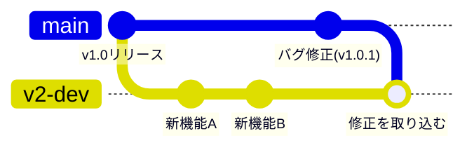
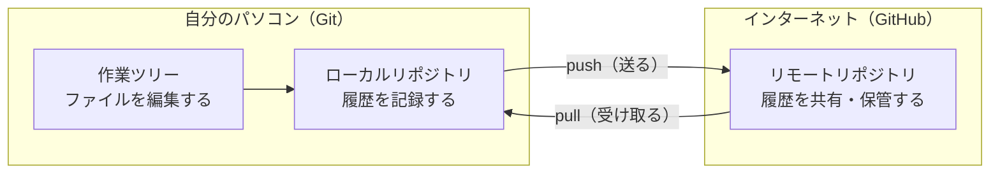

## リリースしたあとに、バグが見つかったら

こんな場面を想像してみてください。

あなたはチームで、あるアプリを開発しています。長い時間をかけて作った **v1.0** を無事にリリースし、いまはお客さんに使ってもらっている状態です。チームはすでに次のバージョン **v2.0** の開発に取りかかり、新しい機能を追加している最中です。

そこへ、連絡が入ります。

> 「いま公開しているv1.0にバグがあります。至急直してください」

ここで困ったことになります。手元のファイルは、すでにv2.0の開発が進んだ状態です。作りかけの新機能があちこちに入っていて、そのままお客さんに届けられる状態ではありません。

つまり、必要なのは次の作業です。

1. **リリース済みのv1.0の状態**を取り出す
2. そこにバグ修正だけを加えて、v1.0.1としてお客さんに届ける
3. 同じバグはv2.0の側にも残っているので、その修正を**開発中のv2.0にも反映する**

### フォルダをコピーして管理すると

履歴を残すしくみがないと、こんなフォルダになりがちです。

```
myapp/                  … いまv2.0を開発中のもの
myapp_v1.0_リリース版/    … リリースしたときにコピーしておいたもの
myapp_v1.0_バグ修正中/    … 今回の修正のためにさらにコピーしたもの
```

これは、原始的な**バージョン管理**です。「リリースした状態を残しておきたい」という気持ちは正しいのですが、この方法には限界があります。

- リリースのたびにコピーを取る必要がある。取り忘れたら、そのときの状態はもう再現できない
- v1.0.1で直した箇所を、v2.0側に手作業で写さなければならない。写し忘れると、直したはずのバグがv2.0で復活する
- どのコピーに何の修正が入っているのか、フォルダ名だけではわからない
- 複数人がそれぞれコピーを持つと、どれが正しいのか誰にもわからなくなる

これらをまとめて解決してくれるのが、**バージョン管理システム**です。

---

## バージョン管理システムがしてくれること

バージョン管理システムを使うと、フォルダをコピーしなくても、**コミットとして記録した過去の時点の状態を取り出せる**ようになります。作業するフォルダは常に1つのままで、記録した変更の履歴が裏側に積み上がっていきます。

具体的には、次のことができます。

### 変更の履歴が残る

コミットすると、「いつ」「誰が」「どのファイルの」「どこを」変更したのかが記録されます。しかも、そのときに「なぜ変更したのか」というメモを添えられます。

### 記録した時点に戻れる

先ほどの場面でいえば、「リリースしたv1.0の状態」をコミットしてあれば、いつでも取り出せます。コピーを取っておく必要はありません。コミットとして記録が残っていれば、その時点に戻れますし、その後にうっかりファイルを消してしまっても復元できます。

:::message alert
未コミットの変更や、Gitがまだ追跡していないファイルは、Gitの履歴には残りません。あとで戻りたい区切りでは、コミットして記録を残しておきましょう。
:::

### 変更点だけを見比べられる

ファイル全体を目で追わなくても、「この修正で変わったのはこの3行だけ」といった形で差分を確認できます。急ぎのバグ修正でも、何を触ったのかがひと目でわかります。

### 枝分かれして、並行して進められる

「v2.0の開発」と「v1.0のバグ修正」のように、性質の違う作業を別々の流れに分けて進められます。この枝分かれのしくみを**ブランチ**と呼びます。バグ修正の作業がv2.0の開発を邪魔することはありませんし、その逆もありません。

### 枝分かれした流れを合流させられる

分かれた流れは、あとでひとつに合わせられます。v1.0.1で直した内容をv2.0側に取り込むとき、手作業で写す必要はありません。システムが「この修正を取り込んでください」という指示だけで反映してくれます。

先ほどの場面をGitで進めると、履歴はこんな形になります。



丸ひとつが1回の記録です。v1.0をリリースした地点で流れが枝分かれし、一方でv1.0のバグを直しながら、もう一方でv2.0の開発を続けています。そして最後に、バグ修正をv2.0の流れにも合流させています。

いまは図の意味がぼんやりわかれば十分です。実際の操作は、第11章「ブランチを使う」と第12章「合流させる（merge とコンフリクト）」で手を動かしながら学びます。

### 複数人の作業を合流させられる

AさんとBさんが別々の場所を直しても、システムが自動的にひとつにまとめてくれます。同じ場所を直してしまった場合は「ここがぶつかっています」と教えてくれるので、人間が判断して解決します。

---

## Gitとは

**Git** は、いま世界でもっとも使われているバージョン管理システムです。2005年、Linuxカーネル（基本ソフトLinuxの中核部分）を開発するために作られました。

Gitの特徴は、**自分のパソコンの中に履歴のすべてが入っている**という点です。インターネットにつながっていなくても、履歴を見たり、過去に戻したり、新しい記録を作ったりできます。

```
自分のパソコン
├── 作業中のファイル
└── .git ← ここに全履歴が入っている
```

この `.git` というフォルダが、Gitの本体です。ファイルを直接開くことはありませんが、「履歴はここに入っているんだな」と覚えておいてください。

:::message
Gitは、テキストファイルだけでなく、画像などのバイナリファイルも追跡できます。ただし、行単位の差分を確認できる文章・設定ファイル・CSVなど、**テキストファイルの管理を特に得意とします**。大容量のファイルや頻繁に更新するバイナリファイルはリポジトリが大きくなりやすいため、必要に応じてGit LFSなどの仕組みを検討します。この本では、Markdownで書いたメモを題材にします。
:::

---

## GitHubとは

**GitHub** は、Gitの履歴をインターネット上に置いて共有できるサービスです。

Gitは自分のパソコンの中だけで完結するので、そのままでは次のことができません。

- パソコンが壊れたときに履歴を守る
- 別のパソコンで続きの作業をする
- 他の人に自分のコードを見てもらう
- チームで同じプロジェクトを進める

GitHubは、この「インターネット上の置き場所」を提供してくれます。加えて、次のような開発を助ける機能もついています。

| 機能 | 何ができるか |
|---|---|
| リポジトリのホスティング | 履歴つきでコードを保管する |
| プルリクエスト | 変更をレビューしてから取り込む |
| Issue | やることや不具合を管理する |
| Actions | テストや公開作業を自動化する |
| Pages | Webサイトとして公開する |

---

## GitとGitHubの関係

よくある誤解が「GitとGitHubは同じもの」というものです。実際には、はっきりと役割が分かれています。

| | Git | GitHub |
|---|---|---|
| 正体 | パソコンで動くソフトウェア | インターネット上のサービス |
| 役割 | 履歴を記録する | 履歴を共有・保管する |
| 使う場所 | 自分のパソコン | インターネット上（ブラウザやGitコマンドから利用） |
| 提供元 | オープンソース | GitHub社（Microsoft傘下） |
| なしで済むか | Gitがないと始まらない | なくてもGitは使える |

2つの関係を図にすると、次のようになります。



履歴を記録するところまではGitだけで完結します。GitHubは、その履歴を外に置いて共有するための場所です。

イメージとしては、次のような関係です。

- **Git** = 写真を撮るカメラ
- **GitHub** = 撮った写真を保管して、人に見せられるオンラインアルバム

カメラだけでも写真は撮れます。アルバムに載せるのは、保管したいときや人に見せたいときです。

:::message
GitHubと似たサービスに、GitLab、Bitbucket、Azure DevOpsなどがあります。ローカルで使うGitの基本コマンドは共通ですが、リモートURLや認証方法、レビュー機能の名称・画面などはサービスごとに異なります。この本ではもっとも利用者の多いGitHubを使います。
:::

---

## この本で作るもの

これから、**個人のメモ帳リポジトリ**を作りながら学んでいきます。

```
my-notes/
├── README.md      … このリポジトリの説明
└── notes/
    ├── todo.md    … やることリスト
    └── books.md   … 読みたい本のリスト
```

シンプルなMarkdownファイルだけの構成です。プログラミングの知識がなくても進められますし、Gitの操作そのものに集中できます。

チュートリアルが終わったあとも、そのまま自分のメモ帳として使えます。

---

## 覚えておきたい用語

この章で出てきた用語と、次の章から使う用語をまとめておきます。いまは眺めるだけで大丈夫です。

| 用語 | 意味 |
|---|---|
| リポジトリ | Gitで管理するプロジェクトのまとまり。履歴の保管場所 |
| コミット | 変更をひとつの区切りとして記録すること、またはその記録 |
| ローカル | 自分のパソコンのこと |
| リモート | GitHubなど、インターネット上の置き場所のこと |
| プッシュ | ローカルの履歴をリモートに送ること |
| プル | リモートの履歴をローカルに取り込むこと |
| ブランチ | 履歴を枝分かれさせて、並行して作業するしくみ |

---

次の章では、Gitが使える状態になっているかを確認し、初期設定を済ませます。
