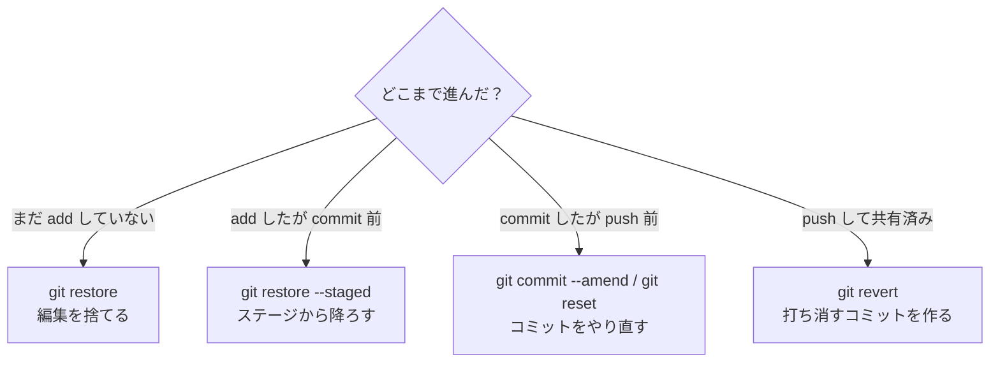

Gitを使う大きな理由のひとつが、「間違えても元に戻せる」ことです。この章では、状況別のやり直し方法を整理します。

やり直しのコマンドは種類が多く、名前も似ていて混乱しがちです。**「どの段階まで進んでしまったか」で使うコマンドが決まる**、と考えると整理しやすくなります。

| いまの状況 | 使うコマンド |
|---|---|
| 編集したが、まだ `add` していない | `git restore` |
| `add` したが、まだ `commit` していない | `git restore --staged` |
| `commit` したが、まだ `push` していない | `git commit --amend` / `git reset` |
| `push` して他の人と共有済み | `git revert` |

図にすると、次のような分かれ道になります。



---

## 編集を取り消す（addする前）

`notes/todo.md` を、うっかりめちゃくちゃに書き換えてしまったとします。

```markdown:notes/todo.md
あああああああ
```

状態を確認します。

```bash
git status
```

```
Changes not staged for commit:
  (use "git add <file>..." to update what will be committed)
  (use "git restore <file>..." to discard changes in working directory)
	modified:   notes/todo.md
```

Gitが親切に「`git restore <file>` で捨てられますよ」と教えてくれています。そのとおりにします。

```bash
git restore notes/todo.md
```

ファイルを開き直すと、編集前の状態に戻っています。最後のコミット時点の内容で、ファイルが上書きされたのです。

:::message alert
`git restore` で捨てた変更は**元に戻せません**。Gitはコミットしていない変更を記録していないため、復元する手段がないのです。実行する前に、本当に捨ててよいか確認してください。
:::

すべてのファイルの変更をまとめて捨てたいときは、次のように書きます。

```bash
git restore .
```

---

## ステージから降ろす（commitする前）

`git add` はしたけれど、「やっぱりこのファイルは今回のコミットに含めたくない」というときです。

```bash
git add notes/todo.md
git status
```

```
Changes to be committed:
  (use "git restore --staged <file>..." to unstage)
	modified:   notes/todo.md
```

ここでも案内が出ています。

```bash
git restore --staged notes/todo.md
```

これでステージから降ります。**ファイルの中身は変わりません**。「次のコミットに含める」という予約を取り消しただけです。

:::message
`git restore` と `git restore --staged` の違いは重要です。

- `git restore ファイル` … ファイルの中身を元に戻す（**変更が消える**）
- `git restore --staged ファイル` … ステージから降ろすだけ（**変更は残る**）

`--staged` を付け忘れると、せっかくの編集が消えてしまいます。
:::

---

## 直前のコミットをやり直す

コミットした直後に「メッセージを間違えた」「1ファイル入れ忘れた」と気づくことはよくあります。そんなときは `git commit --amend` です。

### メッセージだけを直す

```bash
git commit --amend -m "正しいメッセージ"
```

直前のコミットのメッセージが差し替わります。

### ファイルを追加し忘れた

```bash
git add 忘れていたファイル
git commit --amend --no-edit
```

`--no-edit` は「メッセージはそのままでいい」という指定です。直前のコミットに、あとから追加したファイルが含まれた状態になります。

:::message alert
`--amend` は、直前のコミットを**新しいコミットに置き換えます**。コミットIDも変わります。すでに `push` して他の人と共有しているコミットに使うと、相手の履歴と食い違ってトラブルになります。**pushする前だけ**に使ってください。
:::

---

## コミットそのものを取り消す（reset）

「コミットしたけれど、まるごとなかったことにしたい」というときは `git reset` を使います。

`git reset` には3つのモードがあり、**どこまで巻き戻すか**が異なります。

| モード | コミット | ステージ | 作業ツリー（ファイルの中身） |
|---|---|---|---|
| `--soft` | 取り消す | そのまま | そのまま |
| `--mixed`（既定） | 取り消す | 取り消す | そのまま |
| `--hard` | 取り消す | 取り消す | **元に戻す（変更が消える）** |

### `--soft`: コミットだけ取り消す

```bash
git reset --soft HEAD~1
```

直前のコミットが取り消され、その内容が**ステージに載ったまま**残ります。「コミットメッセージを書き直したい」「もう少し変更を足してからコミットし直したい」というときに便利です。

### `--mixed`: ステージからも降ろす

```bash
git reset HEAD~1
```

コミットが取り消され、変更は**作業ツリーに残る**（ステージからは降りる）状態になります。オプションを書かないとこのモードになります。

「add するファイルを選び直したい」というときに使います。

### `--hard`: 完全に巻き戻す

```bash
git reset --hard HEAD~1
```

コミットも変更も、すべてなかったことになります。ファイルの中身も1つ前のコミット時点に戻ります。

:::message alert
`--hard` は、Gitでもっとも危険なコマンドのひとつです。作業中の変更が問答無用で消えます。使う前に、次の2点を確認してください。

1. 本当に捨ててよい変更か
2. `git status` で、消えて困るものが残っていないか

もし迷うなら、`--hard` の代わりにまず `--soft` を試してください。あとから捨てることはできますが、捨てたものを拾うのは大変です。
:::

`HEAD~1` の数字を変えれば、複数のコミットをまとめて取り消せます。

```bash
git reset --hard HEAD~3
```

---

## 共有済みのコミットを取り消す（revert）

`reset` や `--amend` は、**履歴そのものを書き換える**コマンドです。自分ひとりのローカルなら問題ありませんが、すでにGitHubにpushして他の人が取り込んでいる場合、履歴の食い違いが起きて全員が困ります。

そんなときは `git revert` を使います。

```bash
git revert a1b2c3d
```

これは「指定したコミットの変更を打ち消す、**新しいコミット**を作る」という動作です。


`C'` が「`C` を打ち消すコミット」です。

過去の履歴は一切書き換わりません。「Cというコミットがあった」という事実も、「それを取り消した」という事実も、両方が残ります。

:::message
`reset` と `revert` の使い分けは、次のように覚えてください。

- **自分だけの履歴** → `reset`（なかったことにする）
- **共有済みの履歴** → `revert`（取り消したことを記録に残す）
:::

`revert` を実行するとコミットメッセージの入力画面が開きます。既定のメッセージのままでよければ、そのまま保存して閉じてください。エディタを開かずに実行したい場合は、次のように書きます。

```bash
git revert --no-edit a1b2c3d
```

---

## 過去の状態を見に行く

「昔のバージョンの中身を確認したいだけ」というときは、`git switch --detach` でその時点に移動できます。

```bash
git switch --detach a1b2c3d
```

ファイルの中身が、そのコミット時点の状態になります。確認が終わったら、元に戻ります。

```bash
git switch -
```

`-` は「ひとつ前にいた場所」を意味します。

:::message
過去のコミットに移動している間は、`HEAD` がブランチから離れた状態（detached HEAD）になります。この状態でコミットしても、どのブランチにも属さない宙ぶらりんの記録になってしまいます。**見るだけ**にとどめて、すぐ戻るようにしてください。
:::

---

## 最後の砦: `git reflog`

「`reset --hard` で消してしまった」「間違って `--amend` した」というとき、あきらめる前に試すべきコマンドがあります。

```bash
git reflog
```

```
7f3a9c2 (HEAD -> main) HEAD@{0}: reset: moving to HEAD~1
e8d9a0b HEAD@{1}: commit: 消してしまったコミット
7f3a9c2 HEAD@{2}: commit: todoに項目を追加
4d5e6f7 HEAD@{3}: commit: メモ用のnotesフォルダを追加
```

`reflog` は、`HEAD` が移動したすべての記録です。`git log` には出てこない「消したはずのコミット」も残っています。

戻りたい地点のIDがわかったら、そこへ移動できます。

```bash
git reset --hard e8d9a0b
```

:::message
`reflog` が記録しているのは、`HEAD` やブランチが**どこを指していたか**の移動履歴です。裏を返すと、**一度もコミットしていない編集は `reflog` にも残りません**。だからこそ、「区切りがついたらこまめにコミットする」ことが、いちばんの保険になります。
:::

---

## この章のまとめ

| やりたいこと | コマンド |
|---|---|
| 編集を捨てる | `git restore ファイル` |
| ステージから降ろす | `git restore --staged ファイル` |
| 直前のコミットを修正 | `git commit --amend` |
| コミットを取り消す（変更は残す） | `git reset HEAD~1` |
| 完全に巻き戻す | `git reset --hard HEAD~1` |
| 共有済みの変更を打ち消す | `git revert コミットID` |
| 消したコミットを探す | `git reflog` |

覚えておきたい原則は2つです。

1. **こまめにコミットしておけば、たいていのミスは取り返せる**
2. **`--hard` と `--amend` は、pushする前だけに使う**

---

次の章では、そもそも記録したくないファイルを除外する方法を学びます。
