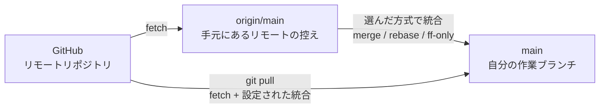
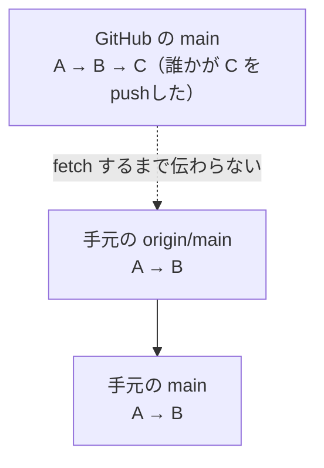

GitHubにリポジトリを置いたことで、「別の場所から取ってくる」ことができるようになりました。この章では、その方法を学びます。

---

## `git clone` でリポジトリを複製する

**clone（クローン）** は、リモートリポジトリをまるごと自分のパソコンに複製するコマンドです。

- 新しいパソコンで作業を始めるとき
- 他の人が公開しているリポジトリを手元で動かしたいとき
- チームのプロジェクトに参加するとき

こうした場面で最初に使います。

### 実際に試してみる

別のパソコンを用意しなくても、同じパソコンの違う場所にcloneすれば体験できます。

```bash
cd ~/git-practice
git clone git@github.com:taro/my-notes.git my-notes-copy
```

```
Cloning into 'my-notes-copy'...
remote: Enumerating objects: 15, done.
remote: Counting objects: 100% (15/15), done.
remote: Compressing objects: 100% (10/10), done.
Receiving objects: 100% (15/15), done.
```

`my-notes-copy` というフォルダができました。中に入って確認します。

```bash
cd my-notes-copy
ls
git log --oneline
```

ファイルも履歴も、すべてそろっています。**cloneは、履歴を含めた完全な複製**を作るのです。

:::message
最後の `my-notes-copy` は、保存先のフォルダ名の指定です。省略すると、リポジトリ名（この場合は `my-notes`）がそのままフォルダ名になります。今回は元のフォルダと同じ場所に置くので、名前を変えました。
:::

### cloneするとリモートも設定済み

cloneしたリポジトリでは、`origin` の登録が最初から済んでいます。

```bash
git remote -v
```

```
origin	git@github.com:taro/my-notes.git (fetch)
origin	git@github.com:taro/my-notes.git (push)
```

`git remote add` をやり直す必要はありません。すぐにpushできる状態です。

---

## 別の場所での変更をpushする

`my-notes-copy` のほうで、ファイルを編集してみましょう。「別のパソコンで作業している」つもりで進めます。

```markdown:notes/books.md
# 読みたい本

- 銀河鉄道の夜
- 吾輩は猫である
- こころ
- 人間失格
```

コミットしてpushします。

```bash
git add notes/books.md
git commit -m "読みたい本に「人間失格」を追加"
git push
```

これでGitHub側が最新になりました。しかし、元の `my-notes` フォルダは、まだこの変更を知りません。

---

## `git pull` でリモートの変更を取り込む

元のフォルダに戻って、状態を見てみます。

```bash
cd ~/git-practice/my-notes
cat notes/books.md
```

「人間失格」は入っていません。本書ではmerge方式で取り込むため、オプションで明示します。

```bash
git pull --no-rebase
```

```
remote: Enumerating objects: 5, done.
remote: Counting objects: 100% (5/5), done.
remote: Compressing objects: 100% (2/2), done.
remote: Total 3 (delta 1), reused 3 (delta 1), pack-reused 0
Unpacking objects: 100% (3/3), done.
From github.com:taro/my-notes
   8a7b6c5..9b8c7d6  main       -> origin/main
Updating 8a7b6c5..9b8c7d6
Fast-forward
 notes/books.md | 1 +
 1 file changed, 1 insertion(+)
```

もう一度ファイルを見ると、「人間失格」が入っています。

```bash
git log --oneline
```

履歴にも、`my-notes-copy` で作ったコミットが反映されています。

:::message
`Fast-forward`（早送り）という表示は、「自分のほうには新しいコミットがなかったので、リモートの状態にそのまま進めました」という意味です。merge方式を指定していても、分岐がなければ新しいmerge commitは作られず、早送りになります。
:::

---

## `git fetch` と `git pull` の違い

Gitには、取ってくるコマンドが2つあります。

| コマンド | 動作 |
|---|---|
| `git fetch` | リモートの最新情報を**取ってくるだけ**。作業中のファイルは変わらない |
| `git pull` | 取ってきたあと、設定やオプションで選ばれた方式で現在のブランチへ統合する |

`git pull` がfetch後に使う主な方式は次のとおりです。

| 方式 | 動作 |
|---|---|
| merge | 必要ならmerge commitを作って統合する。本書ではこの方式を使う |
| rebase | ローカルコミットをリモートの続きへ並べ直す |
| fast-forward only | 早送りできる場合だけ進め、分岐していたら停止する |

本書の `git pull --no-rebase` は、「fetchしてからmerge方式で統合する」と明示したものです。



設定やコマンドラインオプションによって結果が変わるため、`git pull` が常に `fetch + merge` になるわけではありません。チームの方針がある場合は、それに合わせます。

### `fetch` の使いどころ

「いきなり統合するのは怖い。まず何が来ているか確認したい」というときに使います。

```bash
git fetch origin
```

取得後、リモートの状態と自分の状態を比べられます。

```bash
git log --oneline --graph --decorate main..origin/main
git diff main..origin/main
```

「自分の `main` にはなくて、`origin/main` にあるコミット」と差分を確認できます。内容を理解して問題なければ、本書の方式で統合します。

```bash
git merge origin/main
```

:::message
慣れるまでは、方式を明示した `git pull --no-rebase` でもかまいません。ただし、大きなプロジェクトや、他の人が頻繁に変更しているリポジトリでは、`fetch` してから中身を見る習慣が役に立ちます。
:::

### `origin/main` とは

`origin/main` は「**最後に確認したときの、リモートの `main` ブランチの状態**」を指します。

重要なのは、これが自動更新されないことです。GitHub上で誰かがpushしても、自分が `fetch` または `pull` するまで、手元の `origin/main` は古いままです。



「なぜか最新になっていない」と感じたら、まず `git fetch` を実行してみてください。

---

## 作業中の変更があるときのpull

`git pull` を実行しようとして、次のエラーが出ることがあります。

```
error: Your local changes to the following files would be overwritten by merge:
	notes/todo.md
Please commit your changes or stash them before you merge.
```

「編集中のファイルが上書きされてしまうので、先にコミットするか退避してください」という意味です。対処法は3つあります。

### 1. コミットする（おすすめ）

区切りがついているなら、コミットしてしまうのが素直です。

```bash
git add .
git commit -m "作業中の変更を記録"
git pull --no-rebase
```

### 2. 一時的に退避する（stash）

「まだコミットするほどの状態じゃない」というときは、`git stash` で一時的に脇へどけられます。未追跡ファイルも必要なら、`-u` を付けます。

```bash
git stash push -u -m "pull前の作業退避"
git status
git stash list
git pull --no-rebase
git stash pop
git status
```

`-u` は追跡済みの変更に加えて未追跡ファイルも退避しますが、`.gitignore` で無視されているファイルは含みません。`git status` で作業ツリーが片付いたこと、`git stash list` で退避が作られたことを確認してからpullします。

:::message alert
`git stash pop` で戻す変更と、pullで取り込んだ変更が同じ箇所にあると、競合することがあります。その場合は `git status` で対象を確認し、通常の競合と同じように内容を直して `git add` します。

競合した場合など、stashが一覧に残ることがあります。作業内容が正しく戻ったことを確認してから、不要になったstashを整理してください。
:::

### 3. 変更を捨てる

不要な変更なら、第6章「やり直す（restore・amend・reset・revert）」の `git restore` で捨ててからpullします。

---

## 他人のリポジトリをcloneしてみる

GitHubには、公開されているリポジトリが無数にあります。試しにひとつ取ってきてみましょう。

```bash
cd ~/git-practice
git clone https://github.com/github/gitignore.git
cd gitignore
ls
```

第7章「記録しないファイルを決める（.gitignore）」で紹介した `.gitignore` テンプレート集です。中身を見たり、履歴をたどったりできます。

```bash
git log --oneline -10
```

:::message
公開リポジトリは、誰でもcloneして読めます。ただし、cloneしただけではそのリポジトリへ**書き込む（pushする）権限は得られません**。変更を提案したいときは、第13章のプルリクエストを扱う章で学ぶ仕組みを使います。

HTTPSとSSHは接続・認証の方式であり、書き込み権限そのものではありません。公開リポジトリを読むだけなら認証不要のHTTPSが手軽です。HTTPSでも安全なcredential helperで認証すれば、権限のあるリポジトリへpushできます。反対に、SSHのURLを使ってもGitHub上の権限が自動で付くわけではありません。
:::

---

## 練習用フォルダを片付ける

このあとは元の `my-notes` だけを使います。複製したフォルダは、削除しても残しておいてもかまいません。

削除する場合の第一案は、Finder（macOS）、エクスプローラー（Windows）、Linuxのファイルマネージャーを使う方法です。`~/git-practice` を開き、`my-notes-copy` と `gitignore` だけを選んでゴミ箱へ移動します。元の `my-notes` を選んでいないことを、名前と場所で確認してください。

:::details コマンドで削除する場合
コマンド操作に慣れている場合も、先に現在地と対象を確認します。

macOS / Linux:

```bash
cd ~/git-practice
pwd
ls -la
```

Windows（PowerShell 7）:

```powershell
cd ~/git-practice
Get-Location
Get-ChildItem -Force
```

表示された場所が `git-practice` で、対象が `my-notes-copy` と `gitignore` だけであることを確認してから削除します。

macOS / Linux:

```bash
rm -r -- my-notes-copy gitignore
```

Windows（PowerShell 7）:

```powershell
Remove-Item -Recurse my-notes-copy, gitignore
```

`rm -rf` や `-Force` のような確認を省く指定は、この片付けでは使いません。それでも再帰削除は中身ごと消す操作です。パスを変数やワイルドカードに置き換えず、実行前にもう一度確認してください。
:::

---

## この章のまとめ

- `git clone URL` でリポジトリを履歴ごと複製する
- cloneすると `origin` は設定済み
- `git pull` はfetch後、設定やオプションで選ばれた方式で統合する
- 本書では `git pull --no-rebase` でmerge方式を明示する
- `git fetch` は取ってくるだけなので、統合前に履歴と差分を確認できる
- `origin/main` は「最後に確認したリモートの状態」で、自動では更新されない
- 作業中の変更があってpullできないときは、コミットするか `git stash push -u`
- stashを戻すときにも競合する可能性がある
- HTTPS/SSHと、リポジトリへの書き込み権限は別の話
- フォルダの削除はGUIを第一案にし、対象と場所を確認する

---

次の章からは、Gitのもうひとつの主役、ブランチに入ります。
