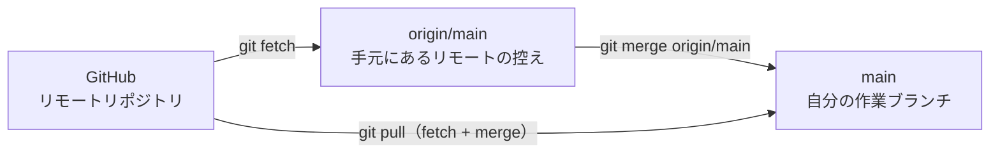
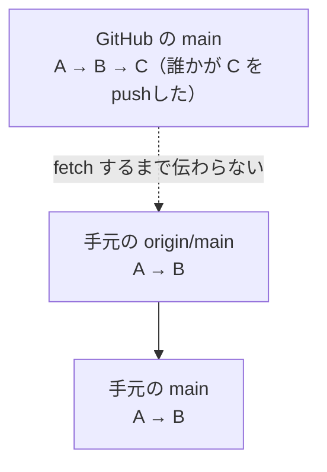

GitHubにリポジトリを置いたことで、「別の場所から取ってくる」ことができるようになりました。この章では、その方法を学びます。

---

## `git clone` でリポジトリを複製する

**clone（クローン）** は、リモートリポジトリをまるごと自分のパソコンに複製するコマンドです。

- 新しいパソコンで作業を始めるとき
- 他の人が公開しているリポジトリを手元で動かしたいとき
- チームのプロジェクトに参加するとき

こうした場面で最初に使います。

### 実際に試してみる

別のパソコンを用意しなくても、同じパソコンの違う場所にcloneすれば体験できます。

```bash
cd ~/git-practice
git clone git@github.com:taro/my-notes.git my-notes-copy
```

```
Cloning into 'my-notes-copy'...
remote: Enumerating objects: 15, done.
remote: Counting objects: 100% (15/15), done.
remote: Compressing objects: 100% (10/10), done.
Receiving objects: 100% (15/15), done.
```

`my-notes-copy` というフォルダができました。中に入って確認します。

```bash
cd my-notes-copy
ls
git log --oneline
```

ファイルも履歴も、すべてそろっています。**cloneは、履歴を含めた完全な複製**を作るのです。

:::message
最後の `my-notes-copy` は、保存先のフォルダ名の指定です。省略すると、リポジトリ名（この場合は `my-notes`）がそのままフォルダ名になります。今回は元のフォルダと同じ場所に置くので、名前を変えました。
:::

### cloneするとリモートも設定済み

cloneしたリポジトリでは、`origin` の登録が最初から済んでいます。

```bash
git remote -v
```

```
origin	git@github.com:taro/my-notes.git (fetch)
origin	git@github.com:taro/my-notes.git (push)
```

`git remote add` をやり直す必要はありません。すぐにpushできる状態です。

---

## 別の場所での変更をpushする

`my-notes-copy` のほうで、ファイルを編集してみましょう。「別のパソコンで作業している」つもりで進めます。

```markdown:notes/books.md
# 読みたい本

- 銀河鉄道の夜
- 吾輩は猫である
- こころ
- 人間失格
```

コミットしてpushします。

```bash
git add notes/books.md
git commit -m "読みたい本に「人間失格」を追加"
git push
```

これでGitHub側が最新になりました。しかし、元の `my-notes` フォルダは、まだこの変更を知りません。

---

## `git pull` でリモートの変更を取り込む

元のフォルダに戻って、状態を見てみます。

```bash
cd ~/git-practice/my-notes
cat notes/books.md
```

「人間失格」は入っていません。取り込みましょう。

```bash
git pull
```

```
remote: Enumerating objects: 5, done.
remote: Counting objects: 100% (5/5), done.
remote: Compressing objects: 100% (2/2), done.
remote: Total 3 (delta 1), reused 3 (delta 1), pack-reused 0
Unpacking objects: 100% (3/3), done.
From github.com:taro/my-notes
   8a7b6c5..9b8c7d6  main       -> origin/main
Updating 8a7b6c5..9b8c7d6
Fast-forward
 notes/books.md | 1 +
 1 file changed, 1 insertion(+)
```

もう一度ファイルを見ると、「人間失格」が入っています。

```bash
git log --oneline
```

履歴にも、`my-notes-copy` で作ったコミットが反映されています。

:::message
`Fast-forward`（早送り）という表示は、「自分のほうには新しいコミットがなかったので、リモートの状態にそのまま進めました」という意味です。いちばん素直な取り込み方です。
:::

---

## `git fetch` と `git pull` の違い

Gitには、取ってくるコマンドが2つあります。

| コマンド | 動作 |
|---|---|
| `git fetch` | リモートの最新情報を**取ってくるだけ**。作業中のファイルは変わらない |
| `git pull` | 取ってきて、**さらに自分のブランチに合流させる** |

つまり、次の関係です。



`git pull` は、この2つの動作をまとめて実行してくれるコマンドです。

### `fetch` の使いどころ

「いきなり合流させるのは怖い。まず何が来ているか確認したい」というときに使います。

```bash
git fetch
```

取得後、リモートの状態と自分の状態を比べられます。

```bash
git log --oneline main..origin/main
```

「自分の `main` にはなくて、`origin/main` にあるコミット」の一覧です。内容を確認して問題なければ、合流させます。

```bash
git merge origin/main
```

:::message
慣れるまでは `git pull` で構いません。ただし、大きなプロジェクトや、他の人が頻繁に変更しているリポジトリでは、`fetch` してから中身を見る習慣が役に立ちます。
:::

### `origin/main` とは

`origin/main` は「**最後に確認したときの、リモートの `main` ブランチの状態**」を指します。

重要なのは、これが自動更新されないことです。GitHub上で誰かがpushしても、自分が `fetch` または `pull` するまで、手元の `origin/main` は古いままです。



「なぜか最新になっていない」と感じたら、まず `git fetch` を実行してみてください。

---

## 作業中の変更があるときのpull

`git pull` を実行しようとして、次のエラーが出ることがあります。

```
error: Your local changes to the following files would be overwritten by merge:
	notes/todo.md
Please commit your changes or stash them before you merge.
```

「編集中のファイルが上書きされてしまうので、先にコミットするか退避してください」という意味です。対処法は3つあります。

### 1. コミットする（おすすめ）

区切りがついているなら、コミットしてしまうのが素直です。

```bash
git add .
git commit -m "作業中の変更を記録"
git pull
```

### 2. 一時的に退避する（stash）

「まだコミットするほどの状態じゃない」というときは、`git stash` で一時的に脇へどけられます。

```bash
git stash
git pull
git stash pop
```

`git stash` で変更を退避し、`git stash pop` で戻します。退避したものの一覧は次のコマンドで見られます。

```bash
git stash list
```

### 3. 変更を捨てる

不要な変更なら、第6章の `git restore` で捨ててから `pull` します。

---

## 他人のリポジトリをcloneしてみる

GitHubには、公開されているリポジトリが無数にあります。試しにひとつ取ってきてみましょう。

```bash
cd ~/git-practice
git clone https://github.com/github/gitignore.git
cd gitignore
ls
```

第7章で紹介した `.gitignore` テンプレート集です。中身を見たり、履歴をたどったりできます。

```bash
git log --oneline -10
```

:::message
公開リポジトリは、誰でもcloneして読めます。ただし**書き込む（pushする）権限はありません**。変更を提案したいときは、第13章で学ぶプルリクエストという仕組みを使います。

なお、他人のリポジトリをcloneするときはHTTPSのURLで構いません。SSHが必要になるのは、自分に書き込み権限があるリポジトリです。
:::

---

## 練習用フォルダを片付ける

このあとは元の `my-notes` だけを使います。複製したフォルダは、削除しても残しておいてもかまいません。削除する場合は次のとおりです。

macOS / Linux:

```bash
cd ~/git-practice
rm -rf my-notes-copy
rm -rf gitignore
```

Windows（PowerShell 7）:

```powershell
cd ~/git-practice
rm -Recurse -Force my-notes-copy
rm -Recurse -Force gitignore
```

:::message alert
どちらも、確認なしでフォルダごと削除するコマンドです。`-r` / `-Recurse` が「中身ごと」、`-f` / `-Force` が「確認せずに」を意味します。パスを打ち間違えると大切なデータが消えます。実行前に、消したいものだけを指定しているか必ず確認してください。
:::

---

## この章のまとめ

- `git clone URL` でリポジトリを履歴ごと複製する
- cloneすると `origin` は設定済み
- `git pull` でリモートの変更を取り込む
- `git fetch` は取ってくるだけ、`git pull` は取り込んで合流まで行う
- `origin/main` は「最後に確認したリモートの状態」で、自動では更新されない
- 作業中の変更があってpullできないときは、コミットするか `git stash`

---

次の章からは、Gitのもうひとつの主役、ブランチに入ります。
