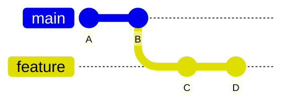
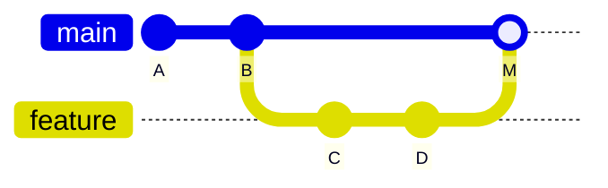
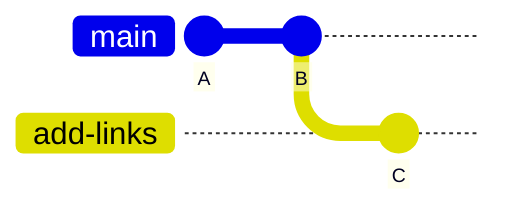
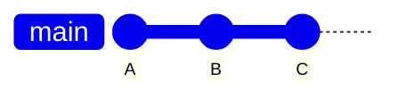

枝分かれさせた変更は、いつか本流に戻します。この章では、**マージ**（合流）と、その際に起きる**コンフリクト**（衝突）の解決方法を学びます。

---

## マージとは

**マージ**は、あるブランチの変更を、別のブランチに取り込む操作です。

マージ前は、`main` と `feature` が枝分かれしたままの状態です。



`main` に `feature` をマージすると、両方の変更を合わせ持つコミットが新しく作られます。



`M` が合流を表す**マージコミット**です。枝分かれした2つの流れが、ここで1本に戻ります。

---

## 単純なマージ（fast-forward）

まずは、いちばん素直なケースから体験します。

`main` に戻って、新しいブランチを作ります。

```bash
cd ~/git-practice/my-notes
git switch main
git switch -c add-links
```

新しいファイルを作ります。

```markdown:notes/links.md
# 参考リンク

- Git公式ドキュメント: https://git-scm.com/doc
- GitHub Docs: https://docs.github.com/ja
```

コミットします。

```bash
git add notes/links.md
git commit -m "参考リンクのメモを追加"
```

`main` に戻って、マージします。

```bash
git switch main
git merge add-links
```

```
Updating 9b8c7d6..1a2b3c4
Fast-forward
 notes/links.md | 4 ++++
 1 file changed, 4 insertions(+)
 create mode 100644 notes/links.md
```

`Fast-forward` と表示されました。

### Fast-forwardとは

`main` が枝分かれしてから一度も進んでいない場合、Gitは合流用の新しいコミットを作りません。`main` という目印を、単に先へ移動させるだけで済むからです。これを**早送り**（fast-forward）と呼びます。

マージ前は、`main` が `B`、`add-links` が `C` を指しています。



マージ後は、`main` の目印が `C` まで進むだけです。新しいコミットは作られません。



いまは `main` と `add-links` が、どちらも `C` を指している状態です。履歴は一本道のままです。

使い終わったブランチを削除しておきます。

```bash
git branch -d add-links
```

---

## マージコミットができるケース

次に、`main` も進んでいる場合を見てみます。

新しいブランチを作って変更します。

```bash
git switch -c update-readme
```

````markdown:README.md
# わたしのメモ帳（個人用）

日々のメモを Markdown で管理するリポジトリです。

## 構成

- `notes/todo.md` … やることリスト
- `notes/books.md` … 読みたい本のリスト

## 使い方

メモを編集したら、コミットして push します。

```bash
git add .
git commit -m "メモを更新"
git push
```
````

1行目だけを変えました（2行目以降は第9章のままです）。コミットします。

```bash
git add README.md
git commit -m "READMEのタイトルに補足を追加"
```

ここで `main` に戻り、**別のファイル**を変更します。

```bash
git switch main
```

```markdown:notes/links.md
# 参考リンク

- Git公式ドキュメント: https://git-scm.com/doc
- GitHub Docs: https://docs.github.com/ja
- Pro Git（日本語版）: https://git-scm.com/book/ja/v2
```

```bash
git add notes/links.md
git commit -m "参考リンクにPro Gitを追加"
```

この時点で、履歴は枝分かれしています。

```bash
git log --oneline --graph --all
```

```
* 5e6f7a8 (HEAD -> main) 参考リンクにPro Gitを追加
| * 6f7a8b9 (update-readme) READMEのタイトルに補足を追加
|/
* 1a2b3c4 参考リンクのメモを追加
```

マージします。

```bash
git merge update-readme
```

今度はエディタが開き、コミットメッセージの入力を求められます。

```
Merge branch 'update-readme'
```

既定のメッセージのままでよいので、そのまま保存して閉じます（vimなら `:wq` と入力してEnter）。

```
Merge made by the 'ort' strategy.
 README.md | 2 +-
 1 file changed, 1 insertion(+), 1 deletion(-)
```

履歴を見てみましょう。

```bash
git log --oneline --graph --all
```

```
*   9a8b7c6 (HEAD -> main) Merge branch 'update-readme'
|\
| * 6f7a8b9 (update-readme) READMEのタイトルに補足を追加
* | 5e6f7a8 参考リンクにPro Gitを追加
|/
* 1a2b3c4 参考リンクのメモを追加
```

枝分かれと合流が、そのまま履歴に残りました。

:::message
異なるファイルを変更している限り、Gitは自動的にきれいに合流させてくれます。「AさんがファイルXを、BさんがファイルYを直した」という状況なら、何も考えずにマージできます。
:::

ブランチを削除します。

```bash
git branch -d update-readme
```

---

## コンフリクトを体験する

問題が起きるのは、**同じファイルの同じ場所**を、両方のブランチで変更したときです。Gitはどちらを採用すべきか判断できないため、人間に判断を求めます。これが**コンフリクト**です。

意図的に起こしてみましょう。

### 準備

ブランチを作って、READMEの1行目を変更します。

```bash
git switch -c rename-title
```

````markdown:README.md
# 山田太郎のメモ帳

日々のメモを Markdown で管理するリポジトリです。

## 構成

- `notes/todo.md` … やることリスト
- `notes/books.md` … 読みたい本のリスト

## 使い方

メモを編集したら、コミットして push します。

```bash
git add .
git commit -m "メモを更新"
git push
```
````

```bash
git add README.md
git commit -m "READMEのタイトルに名前を入れる"
```

`main` に戻って、**同じ1行目**を別の内容に変更します。

```bash
git switch main
```

````markdown:README.md
# My Notes

日々のメモを Markdown で管理するリポジトリです。

## 構成

- `notes/todo.md` … やることリスト
- `notes/books.md` … 読みたい本のリスト

## 使い方

メモを編集したら、コミットして push します。

```bash
git add .
git commit -m "メモを更新"
git push
```
````

```bash
git add README.md
git commit -m "READMEのタイトルを英語にする"
```

### マージしてみる

```bash
git merge rename-title
```

```
Auto-merging README.md
CONFLICT (content): Merge conflict in README.md
Automatic merge failed; fix conflicts and then commit the result.
```

コンフリクトが起きました。

:::message
コンフリクトはエラーでも失敗でもありません。「2人の意図がぶつかったので、どちらを採るか決めてください」というGitからのお願いです。落ち着いて対処すれば大丈夫です。
:::

---

## コンフリクトを解決する

### 1. 状況を確認する

```bash
git status
```

```
On branch main
You have unmerged paths.
  (fix conflicts and run "git commit")
  (use "git merge --abort" to abort the merge)

Unmerged paths:
  (use "git add <file>..." to mark resolution)
	both modified:   README.md
```

`both modified`（両方で変更された）のがコンフリクトしているファイルです。

### 2. ファイルを開く

`README.md` を開くと、見慣れない記号が入っています。ぶつかったのは1行目だけなので、記号が入るのもファイルの先頭部分だけです。

```
<<<<<<< HEAD
# My Notes
=======
# 山田太郎のメモ帳
>>>>>>> rename-title

日々のメモを Markdown で管理するリポジトリです。

（以降は変更がないので、そのまま続きます）
```

記号の意味は次のとおりです。

| 記号 | 意味 |
|---|---|
| `<<<<<<< HEAD` | ここから下が、**いま自分がいるブランチ**（main）の内容 |
| `=======` | 区切り線 |
| `>>>>>>> rename-title` | ここまでが、**取り込もうとしているブランチ**の内容 |

### 3. どうするか決めて書き直す

やることはシンプルです。**記号を全部消して、最終的にこうしたい形にする**。それだけです。

選択肢は3つあります。

- mainの内容を採る
- rename-titleの内容を採る
- 両方を組み合わせた、まったく新しい内容にする

今回は3つ目を選んでみます。

````markdown:README.md
# My Notes（山田太郎のメモ帳）

日々のメモを Markdown で管理するリポジトリです。

## 構成

- `notes/todo.md` … やることリスト
- `notes/books.md` … 読みたい本のリスト

## 使い方

メモを編集したら、コミットして push します。

```bash
git add .
git commit -m "メモを更新"
git push
```
````

:::message alert
`<<<<<<<`、`=======`、`>>>>>>>` の記号を消し忘れたままコミットしてしまう事故は、非常によくあります。保存する前に、記号が1つも残っていないか必ず確認してください。
:::

### 4. 解決したことを伝える

```bash
git add README.md
```

コンフリクトしたファイルを `git add` することが、「解決しました」という合図になります。

```bash
git status
```

```
On branch main
All conflicts fixed but you are still merging.
  (use "git commit" to conclude merge)
```

### 5. コミットする

```bash
git commit -m "READMEのタイトルのコンフリクトを解決"
```

これでマージ完了です。

```bash
git branch -d rename-title
```

---

## マージをやめたいとき

コンフリクトが複雑で「いったん中止したい」と思ったら、いつでも元の状態に戻せます。

```bash
git merge --abort
```

マージ前の状態に完全に戻ります。慌てて変な解決をするより、いったん中止して落ち着いてから取り組むほうが安全です。

---

## コンフリクトを減らすコツ

コンフリクトは避けられないものですが、頻度と規模は減らせます。

### こまめに `main` を取り込む

作業ブランチが長生きするほど、`main` との差が開いてコンフリクトしやすくなります。定期的に取り込みましょう。

```bash
git switch 作業ブランチ
git merge main
```

### ブランチを長生きさせない

「1つのブランチで1つのことをやって、すぐマージする」。これがいちばん効果的です。

### 誰がどこを触っているか共有する

チームで同じファイルを同時に大改造すると、まず衝突します。作業を始める前のひとことが、あとの手間を大きく減らします。

### 自動整形ツールの設定を揃える

コードのインデントや改行を自動で整えるツールは、設定が人によって違うと、意味のない差分を大量に生み、コンフリクトの原因になります。設定ファイルをリポジトリに入れて共有しましょう。

---

## 変更をGitHubに反映する

ここまでの作業をpushしておきます。

```bash
git push
```

---

## この章のまとめ

- `git merge ブランチ名` で、そのブランチの変更を取り込む
- `main` が進んでいなければfast-forward（履歴は一本道のまま）
- 進んでいればマージコミットができる
- 同じ場所を両方で変更するとコンフリクトする
- 解決は「記号を消して、最終形にして、`git add` して `git commit`」
- 中止したいときは `git merge --abort`
- ブランチを長生きさせないことが最大の予防策

---

次の章では、GitHub上でマージを行う「プルリクエスト」を学びます。
