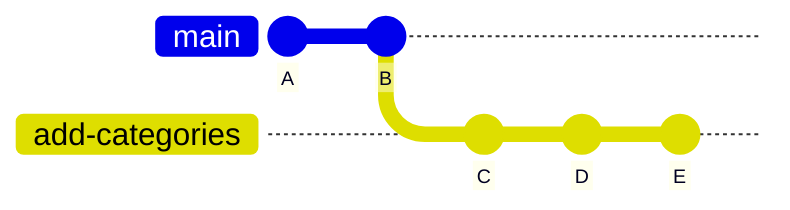
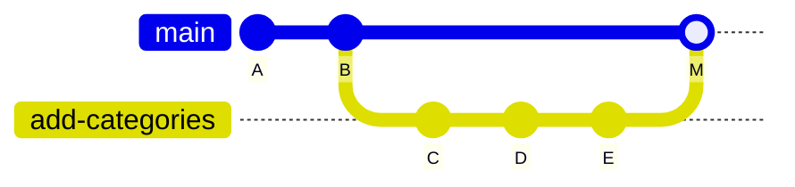
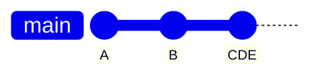
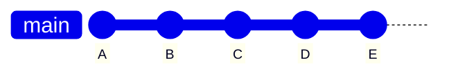
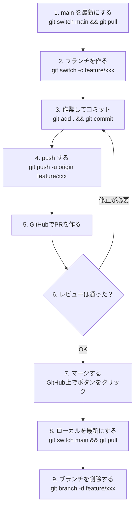

この章では、GitHubの中心的な機能である**プルリクエスト**を使います。第11章で作った `add-categories` ブランチを、この仕組みで `main` に取り込みます。

---

## プルリクエストとは

**プルリクエスト**（Pull Request、略してPR）は、「このブランチの変更を取り込んでください」という提案です。

ローカルで `git merge` すれば、変更はすぐ取り込めます。それなのになぜ、わざわざGitHub上で提案するのでしょうか。理由は、マージの前に**話し合う場**ができるからです。

- 変更内容を、差分として見やすく提示できる
- 他の人がコードを読んでコメントできる
- 「この部分はこうしたほうがよいのでは」という議論が記録に残る
- テストが自動で走り、問題がないか確認できる
- 承認されてからマージする、という手順を強制できる

:::message
「ひとりで開発しているなら不要では」と思うかもしれませんが、そんなことはありません。

- 変更点を自分で見直す機会になる
- 「なぜこの変更をしたのか」を文章で残せる
- あとから「この機能はいつ、どういう意図で入ったのか」を辿れる

ひとりのプロジェクトでもPRを使う開発者は多くいます。この本でも、その流れを体験します。
:::

---

## ブランチの状態を確認する

第11章で作った `add-categories` は、すでにpush済みです。念のため確認します。

```bash
cd ~/git-practice/my-notes
git branch -a
```

```
  add-categories
* main
  remotes/origin/HEAD -> origin/main
  remotes/origin/add-categories
  remotes/origin/main
```

`-a` は「リモートのブランチも含めて表示」というオプションです。`remotes/origin/add-categories` があれば、GitHub側にも存在しています。

:::details pushしていなかった場合
次のコマンドで送ってください。

```bash
git switch add-categories
git push -u origin add-categories
git switch main
```
:::

---

## プルリクエストを作る

ブラウザでGitHubのリポジトリページを開きます。

### 1. Pull requestsタブへ

上部の **Pull requests** タブをクリックし、**New pull request** をクリックします。

ページ上部に黄色い帯で「add-categories had recent pushes」と表示されている場合は、その中の **Compare & pull request** ボタンからでも進めます。

### 2. 比較するブランチを選ぶ

2つのプルダウンが表示されます。

```
base: main  ←  compare: add-categories
```

- **base**: 取り込み**先**。今回は `main`
- **compare**: 取り込み**元**。今回は `add-categories`

向きを間違えやすいので注意してください。「baseに、compareを取り込む」と覚えます。

選ぶと、下に変更内容の差分が表示されます。`git diff` と同じものが、色付きで見やすく表示されています。

### 3. 内容を書く

**Create pull request** をクリックすると、タイトルと説明の入力欄が出ます。

**タイトル**には、何をしたのかを1行で書きます。

```
todoと読みたい本をカテゴリ別に整理
```

**説明**には、背景や確認してほしい点を書きます。Markdownが使えます。

```markdown
## 変更内容

- `notes/todo.md` を「買い物」「勉強」「その他」に分類
- `notes/books.md` を「小説」「技術書」に分類

## 背景

項目が増えてきて、目的のメモを探しにくくなっていたため。

## 確認してほしいこと

- カテゴリの分け方はこれで妥当か
- 「その他」というカテゴリ名は適切か
```

:::message
説明欄に書くべきなのは、「**何を変えたか**」よりも「**なぜ変えたか**」です。何を変えたかは差分を見ればわかりますが、なぜそうしたかは書かないと伝わりません。

これは未来の自分のためでもあります。半年後に「この変更は何のためだったのか」と履歴を辿ったとき、PRの説明が答えを教えてくれます。
:::

### 4. 作成する

**Create pull request** をクリックすると、PRが作られます。番号（`#1` など）が振られ、以降はこの番号で参照できるようになります。

---

## プルリクエストの画面を見る

作成されたPRには、4つのタブがあります。

| タブ | 内容 |
|---|---|
| **Conversation** | 説明とコメントのやりとり |
| **Commits** | 含まれるコミットの一覧 |
| **Checks** | 自動テストなどの結果 |
| **Files changed** | 変更されたファイルの差分 |

### Files changedで差分を確認する

**Files changed** タブを開くと、変更内容が1行ずつ表示されます。

行番号の左にマウスを合わせると **+** ボタンが出ます。これをクリックすると、**その行に対してコメント**を書けます。

```
「その他」より「生活」のほうがわかりやすいかもしれません
```

これがコードレビューの基本操作です。ファイル全体ではなく、気になった行にピンポイントで指摘できるのが便利なところです。

:::message
自分のPRに自分でコメントするのは変に感じるかもしれませんが、練習として一度試してみてください。チーム開発に参加したとき、この操作を知っているかどうかで動きやすさが変わります。
:::

---

## レビューで指摘を受けたら

指摘を受けて修正する場合の流れも見ておきましょう。実際にやってみます。

```bash
git switch add-categories
```

`notes/todo.md` の「その他」を「生活」に変更します。

```markdown:notes/todo.md
# やること

## 買い物

- [x] 牛乳を買う

## 勉強

- [ ] Gitの練習をする
- [ ] GitHubにpushしてみる

## 生活

- [ ] 図書館に本を返す
```

コミットしてpushします。

```bash
git add notes/todo.md
git commit -m "カテゴリ名を「その他」から「生活」に変更"
git push
```

GitHubのPR画面を再読み込みしてください。**追加したコミットが、自動的にPRに反映されています。**

これがPRの重要な性質です。**PRはブランチに紐づいている**ので、同じブランチにpushする限り、PRを作り直す必要はありません。指摘を受けて直す、というやりとりを何度でも繰り返せます。

---

## マージする

内容に納得できたら、**Conversation** タブに戻って **Merge pull request** をクリックします。

### 3つのマージ方法

ボタンの右の三角をクリックすると、3つの選択肢が出ます。

| 方法 | 動作 | 向いている場面 |
|---|---|---|
| **Create a merge commit** | ブランチの全コミットを残し、マージコミットを作る | 作業の経緯をすべて残したいとき |
| **Squash and merge** | 全コミットを1つにまとめて取り込む | 細かいコミットが多く、履歴を整理したいとき |
| **Rebase and merge** | コミットを一列に並べ直して取り込む | 履歴を一本道に保ちたいとき |

図にすると次のようになります。まず、マージする前の状態です。`add-categories` に `C` `D` `E` の3つのコミットがあります。



**Create a merge commit**: 3つのコミットをそのまま残し、合流点として `M` を作ります。



**Squash and merge**: `C` `D` `E` がひとつのコミットにまとまって `main` に載ります。



**Rebase and merge**: `C` `D` `E` が `main` の続きとして並べ直されます。枝分かれの跡は残りません。



:::message
どれを選ぶかはチームの方針次第です。迷ったら **Create a merge commit** で構いません。「いつ、どのPRで入った変更か」がいちばんはっきり残ります。

個人のリポジトリで、細かいコミットを整理したい場合は **Squash and merge** が便利です。
:::

**Confirm merge** をクリックすると、マージが完了します。

### ブランチを削除する

マージ後、**Delete branch** ボタンが表示されます。役目を終えたブランチなので削除してかまいません。

履歴はすべて `main` に取り込まれているので、ブランチを消しても変更内容は失われません。あとから必要になれば、PRの画面から復元することもできます。

---

## ローカルを最新にする

GitHub側でマージしたので、手元の `main` はまだ古いままです。取り込みます。

```bash
git switch main
git pull
```

```
Updating 9a8b7c6..2f3e4d5
Fast-forward
 notes/books.md | 8 +++++++-
 notes/todo.md  | 12 ++++++++++--
 2 files changed, 18 insertions(+), 2 deletions(-)
```

ローカルのブランチも削除します。

```bash
git branch -d add-categories
```

リモートで削除されたブランチの情報が手元に残っている場合は、次のコマンドで整理できます。

```bash
git fetch --prune
```

これで一連の流れが完了しました。

---

## PRを使った開発の全体像

ここまでの流れをまとめると、次のようになります。



**この9ステップが、現代のソフトウェア開発でもっとも標準的な進め方**です。GitHub Flowと呼ばれることもあります。

最初は手数が多く感じますが、繰り返すうちに体が覚えます。

---

## PRでコンフリクトが起きたら

PR画面に、次の表示が出ることがあります。

```
This branch has conflicts that must be resolved
```

`main` が先に進んでいて、同じ場所が変更されている状態です。対処法は2つあります。

### GitHubの画面で解決する

**Resolve conflicts** ボタンをクリックすると、ブラウザ上で編集できます。第12章で見た `<<<<<<<` などの記号を消して最終形にし、**Mark as resolved** → **Commit merge** で完了です。

小さなコンフリクトなら、この方法が手軽です。

### ローカルで解決する（おすすめ）

複雑な場合は、手元で解決するほうが確実です。

```bash
git switch add-categories
git merge main
```

コンフリクトが出るので、第12章と同じ手順で解決します。

```bash
git add 解決したファイル
git commit
git push
```

pushすると、PR画面のコンフリクト表示が消えます。

:::message
ローカルで解決する利点は、**手元でファイルを開いて動作を確認できる**ことです。ブラウザ上の編集では、解決後に本当に正しく動くかを確かめられません。
:::

---

## この章のまとめ

- プルリクエストは「取り込んでください」という提案と、その議論の場
- baseが取り込み先、compareが取り込み元
- 説明には「なぜ変えたか」を書く
- 同じブランチにpushすれば、PRは自動で更新される
- マージ方法は3種類。迷ったらmerge commit
- マージ後は `git pull` でローカルを最新にし、ブランチを削除する
- コンフリクトはローカルで解決するほうが確実

---

次の章では、チームで開発するときの流れを見ていきます。
