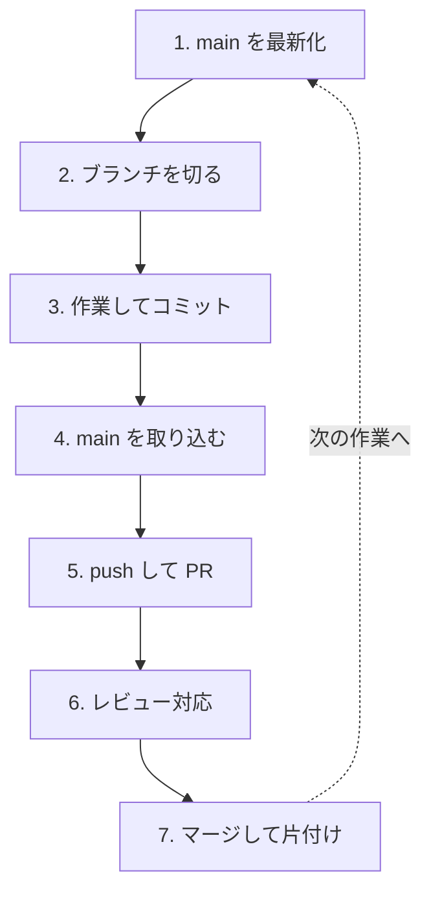

ここまでは、ひとりで完結する使い方を学んできました。この章では、複数人で同じリポジトリを扱うときの流れと、GitHubの支援機能を見ていきます。

---

## メンバーを招待する

自分のリポジトリに他の人を参加させるには、招待が必要です。

1. リポジトリの **Settings** タブ
2. 左メニューの **Collaborators**
3. **Add people** をクリック
4. 相手のGitHubユーザー名かメールアドレスを入力
5. 招待を送る

相手が承認すると、そのリポジトリにpushできるようになります。

:::message
招待されたメンバーは、リポジトリに直接pushできる状態になります。誤って `main` を壊されないよう、次に説明するブランチ保護と組み合わせるのが一般的です。
:::

---

## mainブランチを保護する

チーム開発では、`main` を「常に正常に動く状態」に保つことが重要です。GitHubには、そのための設定があります。

1. **Settings** → **Branches**
2. **Add branch ruleset**（または **Add rule**）をクリック
3. 対象ブランチに `main` を指定

よく使う設定は次のとおりです。

| 設定 | 効果 |
|---|---|
| Require a pull request before merging | `main` への直接pushを禁止し、PR経由のみにする |
| Require approvals | 指定した人数の承認がないとマージできない |
| Require status checks to pass | 自動テストが通らないとマージできない |
| Block force pushes | `git push --force` を禁止する |

:::message
ひとりのプロジェクトでも「PR必須」にしておくと、うっかり `main` に直接コミットする事故を防げます。ただし、承認人数を1以上にすると自分ではマージできなくなるので、ひとりの場合は0にしておきます。
:::

---

## Issueで作業を管理する

**Issue**（イシュー）は、やることや不具合を管理する仕組みです。

### Issueを作る

1. リポジトリの **Issues** タブ
2. **New issue** をクリック
3. タイトルと本文を書いて **Submit new issue**

書き方の例です。

```markdown
## 現象

メモの検索機能がほしい。ファイルが増えてきて、目的のメモを探すのに時間がかかる。

## 期待する動作

キーワードを入力すると、該当するメモの一覧が表示される。

## 補足

まずはファイル名の検索だけでもよい。
```

作成すると番号（`#2` など）が振られます。

### IssueとPRを連携させる

PRの説明文に、次のように書きます。

```markdown
Closes #2
```

こう書いておくと、**そのPRがマージされたとき、Issueが自動的に閉じられます**。「この作業は、この課題に対応するものだ」という関係も記録されます。

同じ働きをするキーワードは複数あります。

- `Closes #2`
- `Fixes #2`
- `Resolves #2`

どれを使っても構いません。

:::message
コミットメッセージやコメントの中で `#2` と書くだけでも、そのIssueへのリンクになります。番号で会話できるのが、GitHubの便利なところです。
:::

---

## チーム開発の1日の流れ

複数人で開発するときの、典型的な流れを追ってみます。



この7つを、作業のたびに一周します。

### 1. 作業を始める前に最新化する

```bash
git switch main
git pull
```

**これを忘れると、古い状態から作業を始めてしまい、あとでコンフリクトの原因になります。** 作業開始時の儀式だと思ってください。

### 2. ブランチを切る

```bash
git switch -c feature/search-notes
```

担当するIssueの番号を入れる流儀もあります。

```bash
git switch -c feature/2-search-notes
```

### 3. 作業してコミットする

```bash
git add .
git commit -m "メモのファイル名検索を追加"
```

区切りごとにこまめにコミットします。

### 4. 作業中もmainを取り込む

作業が数日にわたるときは、途中で `main` の変更を取り込みます。

```bash
git fetch
git merge origin/main
```

差が小さいうちに合流させておけば、コンフリクトが起きても小規模で済みます。

### 5. pushしてPRを作る

```bash
git push -u origin feature/search-notes
```

GitHubでPRを作り、レビューを依頼します。

### 6. レビューを受けて修正する

指摘があれば修正し、同じブランチにpushします。PRは自動で更新されます。

### 7. マージして片付ける

```bash
git switch main
git pull
git branch -d feature/search-notes
```

---

## レビューする側の作法

チームに慣れてくると、他の人のPRをレビューする側にもなります。基本的な操作を押さえておきましょう。

### レビューの手順

1. PRの **Files changed** タブを開く
2. 気になる行にコメントを付ける
3. 右上の **Review changes** をクリック
4. 全体へのコメントを書き、3つのうちから選ぶ

| 選択肢 | 意味 |
|---|---|
| **Comment** | 感想や質問だけ。承認も却下もしない |
| **Approve** | 承認する。マージしてよい |
| **Request changes** | 修正を求める。直るまでマージできない |

### 手元で動かして確認する

コードを読むだけでなく、実際に動かして確認したいときは、そのブランチを取ってきます。

```bash
git fetch origin
git switch feature/search-notes
```

確認が終わったら戻ります。

```bash
git switch main
```

:::message
レビューのコメントは、書き方ひとつで受け取られ方が大きく変わります。

- 「なぜこうしたのですか？」と聞く（決めつけない）
- 「〇〇にすると△△という利点があります」と理由を添える
- よい部分は素直に褒める
- 好みの問題は「これは好みですが」と前置きする

指摘の対象はコードであって、書いた人ではありません。この前提を共有できているチームは、レビューが健全に回ります。
:::

---

## フォークとオープンソースへの参加

自分に書き込み権限がないリポジトリに変更を提案したいときは、**フォーク**を使います。

### フォークとは

フォークは、他人のリポジトリを**自分のアカウントにコピー**することです。コピーした先には自由にpushできるので、そこで作業してから元のリポジトリにPRを送ります。

### 流れ

1. 対象リポジトリのページで、右上の **Fork** をクリック
2. 自分のアカウントにコピーされる
3. それをcloneする

```bash
git clone git@github.com:自分のユーザー名/リポジトリ名.git
cd リポジトリ名
```

4. ブランチを切って作業し、自分のフォークにpushする

```bash
git switch -c fix/typo-in-readme
git add .
git commit -m "READMEの誤字を修正"
git push -u origin fix/typo-in-readme
```

5. GitHubで、**元のリポジトリに向けて**PRを作る

フォーク元との差分から、GitHubが自動的にPR作成を提案してくれます。

:::message
オープンソースへの最初の貢献としては、ドキュメントの誤字修正や、翻訳の改善がおすすめです。コードの変更より敷居が低く、それでいて確実に役に立ちます。

多くのプロジェクトには `CONTRIBUTING.md` という参加ガイドがあります。PRを送る前に必ず目を通してください。
:::

### フォーク元の最新を取り込む

フォークしたリポジトリは、元が更新されても自動では追随しません。取り込むには、元のリポジトリをもう1つのリモートとして登録します。

```bash
git remote add upstream git@github.com:元のユーザー名/リポジトリ名.git
git fetch upstream
git switch main
git merge upstream/main
```

`upstream`（上流）は、フォーク元を指す慣習的な名前です。

---

## 覚えておくと便利な機能

### Draft Pull Request

まだ完成していないけれど、方向性を早めに相談したい。そんなときは **Create draft pull request** を選びます。

- レビュー依頼としては扱われない
- マージボタンは押せない
- 完成したら **Ready for review** に切り替える

「大きく作り込んでから全部やり直し」を防げる、実用的な機能です。

### テンプレート

リポジトリに次のファイルを置いておくと、PRやIssueを作るときに自動で内容が埋まります。

- `.github/pull_request_template.md`
- `.github/ISSUE_TEMPLATE/bug_report.md`

チーム全員が同じ観点で書けるようになり、レビューが楽になります。

### GitHub Actions

`.github/workflows/` にYAMLファイルを置くと、pushやPRのたびに自動で処理を走らせられます。

- テストを実行する
- コードの書き方をチェックする
- サイトを自動で公開する

「テストが通らないPRはマージできない」といった仕組みは、この機能で実現されています。

---

## この章のまとめ

- Collaboratorとしてメンバーを招待する
- `main` はブランチ保護でPR必須にする
- Issueで作業を管理し、PRの説明に `Closes #番号` と書いて連携させる
- 作業開始前の `git switch main && git pull` を習慣にする
- レビューはコードに対して行い、人に対して行わない
- 権限のないリポジトリにはフォークして貢献する

---

次の章では、つまずいたときの対処法をまとめます。
